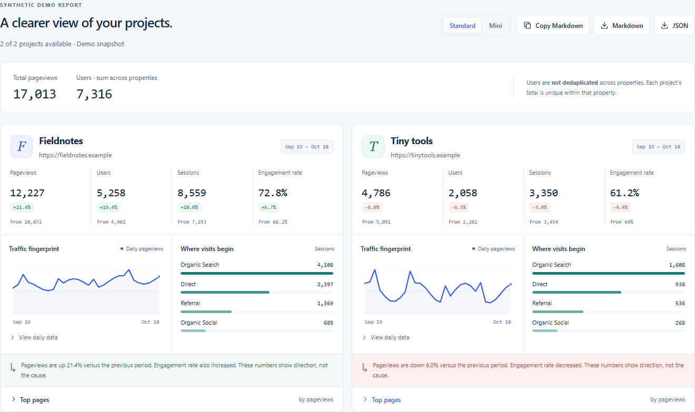

# Monthly

A free, self-hosted Google Analytics 4 dashboard for your projects. Compare up to **12 GA4 properties** in one workspace, spot changes in traffic, and export a report without editing source code.

Bring your own Google service-account key and run Monthly locally or on a server you trust. Google API calls run on the Next.js server, **not only in your browser**.



*The built-in demo uses deterministic synthetic data and reserved example domains. This screenshot contains no credentials, personal details, or real analytics.*

## What you can do

- **Add properties without a form.** Discover properties your key can access, select one or several, and add them immediately. Names and website URLs come from GA4; use Edit afterward if needed.
- **Keep setup compact.** Saved projects use compact tiles in a full-width workspace. The discovery list collapses after adding properties, and connection settings collapse after successful discovery or reporting.
- **Compare reporting windows.** Choose 7, 30, or 90 days and an end date. Every property is compared with the immediately preceding, equal-length period.
- **See the numbers and the pattern.** View pageviews, unique users, sessions, engagement rate, daily traffic, acquisition channels, and top pages.
- **Take the report with you.** Download Markdown or JSON, or copy Markdown. Exports include the complete report regardless of the selected view, never credentials.
- **Try it before connecting.** Explore two fictional projects without a Google account, key, or analytics API request.

### Standard and Mini views

Switch views above the generated report without making another GA4 request.

| View | Wide-screen layout | What each project shows |
| --- | --- | --- |
| **Standard** | Two projects per row, two charts per project | All four metrics, traffic and channel charts, a traffic summary, and expandable data tables |
| **Mini** | Four projects per row, one small graph per project | Pageviews, the change from the previous period, and a compact daily traffic graph |

Both layouts adapt to smaller screens. Top pages and daily data start collapsed in Standard view. Switch back from Mini to see all details.

## Quick start

Requires **Node.js 22.14 or later** and npm.

```powershell
npm ci
npm run dev
```

Open **http://localhost:3000** and choose **Explore demo**, or connect your own GA4 account. The dashboard needs no environment variables: enter its credentials in the UI.

## Connect Google Analytics

**GA4 reporting does not use a Measurement Protocol API secret.** That secret sends events; it cannot read reports. Monthly needs a Google service-account JSON key and a numeric GA4 **property ID**, not a `G-...` measurement ID.

1. In [Google Cloud Console](https://console.cloud.google.com/), create or select a project and enable the **Google Analytics Data API**. Also enable the **Google Analytics Admin API** to discover properties automatically.
2. Create a service account under **IAM & Admin > Service Accounts**, then create a JSON key.
3. In GA4, open **Admin > Property access management** and add the service-account email as a **Viewer** for each property you want to report on.
4. In Monthly, import/paste the service-account JSON, or enter its email and private key.
5. Choose **Find GA4 properties**, then **Add property** or select several and choose **Add properties**. Alternatively, choose **Add project** and enter the numeric property ID manually. A website URL is optional.
6. Choose a period and generate your report.

### Credential entry

- Paste or upload the full service-account JSON, or enter **both** its email and private key manually. A complete pasted JSON key works immediately; **Load pasted key** is not required first.
- Manual keys accept actual line breaks, literal `\n` sequences, and Windows CRLF line breaks. Monthly retains the original entry and normalizes it before authentication.
- Keys are hidden by default. **Show private key** and **Hide private key** control visibility; reloads, switching entry methods, loading a key, or clearing credentials hide it again.
- Refreshing the same tab restores complete or incomplete credential drafts and the selected entry method. Restored credentials are marked unverified until discovery or reporting succeeds.
- Select **Connection** in navigation or **Edit connection** to reopen collapsed settings. An incomplete entry produces guidance when you choose **Find GA4 properties**, rather than leaving that button permanently disabled.

Use a dedicated, least-privilege service account. Never commit a key or paste it into a report. Revoke a compromised key in Google Cloud.

## Property discovery

Discovery uses the read-only [Analytics Admin API `accountSummaries.list`](https://developers.google.com/analytics/devguides/config/admin/v1/rest/v1beta/accountSummaries/list). It lists GA4 properties visible to the supplied service account, not Google Cloud projects. The private key alone is insufficient: the matching service-account email is also required.

- Select individual properties, **Select all**, or **Select first N** when fewer workspace slots remain. **Load more properties** preserves selections across pages.
- Adding a property reads its web data streams and uses the first website URL, if available. Multiple websites produce a notice; properties without a URL are still added. Reporting uses the property ID, not the URL.
- Single and bulk additions save immediately, with no review form or extra save step. They leave any manual project draft unchanged.
- Bulk website lookups run at most three requests concurrently. A failed lookup adds nothing; **Cancel lookup** also preserves your selection. Fix the reported problem and retry.
- Already-added properties are marked **Added**. Duplicate properties and the **12-project limit** are checked before adding the whole selection.
- After an addition, choose **Show GA4 properties** to reopen the collapsed list without fetching again. Saved projects survive refreshes; blocked or full browser storage produces an explicit warning and **Retry saving** action.

A disabled Admin API does not prevent reporting on manually configured properties through the Data API.

## Privacy and data handling

| Data | Where it lives | What survives a refresh |
| --- | --- | --- |
| Project names, property IDs, optional URLs | This browser's local storage | Project settings, on the same origin and browser profile; no cross-device sync |
| Credential drafts and entry method | This tab's session storage | Complete and incomplete entries; key visibility resets to hidden |
| Discovered properties, selections, generated reports | Page memory | Nothing; credential changes also clear discovery results |
| Markdown and JSON exports | Your clipboard or downloaded files | The full exported report, without credentials |

Finding properties, reading website URLs, and generating reports send credentials to **the server hosting Monthly**, which authenticates with Google. The dashboard uses request-isolated Google clients, does not fall back to host environment credentials, and does not intentionally persist credentials on the server. Credential-bearing requests and report responses are not cached.

**Session storage is not an encrypted vault.** Scripts running on this origin can read it. Browser session restore or duplicated tabs may retain a copy. Use a trusted deployment and device, and choose **Clear & forget credentials** before leaving a shared device.

Google receives the authentication, property IDs, and reporting queries required for its APIs. Exported reports can contain sensitive business data even though they exclude credentials; share them deliberately.

## How to read the numbers

- Traffic summaries use green for growth, red for declines, and neutral styling for unchanged traffic or a zero comparison baseline.
- Date ranges are inclusive: a 30-day report has exactly 30 calendar dates. The comparison period ends the day before the current period begins.
- Dates are interpreted in each GA4 property's reporting timezone. Today's data can be incomplete; Google processing delays also affect recent dates.
- Active users are fetched as a distinct count over the full period, not calculated by adding daily users. Users summed across different properties are **not deduplicated**.
- Engagement rate is the share of engaged sessions. Its relative percentage change is not a percentage-point change.
- Activity against a zero comparison baseline is shown as **New**, not an infinite growth percentage. Two zero periods are unchanged.
- Zero-filled chart dates represent dates with no returned activity. An API failure is displayed as an error, not zero traffic.
- Channel bars use session counts. GA4 privacy thresholds, sampling, and `(other)` aggregation can affect breakdowns; use GA4 for deeper investigation.
- Each project is independent: one inaccessible property does not hide successful reports for other projects.
- Search Console and Ahrefs are not required by the dashboard. It does not invent retention estimates or substitute demo data when a live request fails.

## Dashboard API

All three dashboard endpoints accept explicit service-account credentials, validate bounded JSON requests, and return `Cache-Control: no-store`. Browser requests must be same-origin. Google failures remain errors, not zero or demo results.

| Endpoint | Input besides `credentials` | Response |
| --- | --- | --- |
| `POST /api/dashboard` | `projects`, `endDate`, `days` | `reports`, per-project `errors`, `generatedAt` |
| `POST /api/properties` | Optional opaque `pageToken` | `properties` with `propertyId`, `name`, `accountName`; `nextPageToken` |
| `POST /api/property-website` | Numeric `propertyId` | `urls`: deduplicated HTTP(S) web stream URLs, or an empty array |

Example reporting request, with credential placeholders only:

```json
{
  "projects": [
    {
      "id": "my-site",
      "name": "My website",
      "url": "https://example.com",
      "propertyId": "123456789"
    }
  ],
  "credentials": {
    "client_email": "<service-account email>",
    "private_key": "<service-account PEM private key>"
  },
  "endDate": "2026-10-18",
  "days": 30
}
```

The request supports 1-12 projects and `days` of `7`, `30`, or `90`. The `url` field must be a string: use `""` when the property has no website URL, or a full HTTP(S) URL without embedded credentials. Reporting queries use `propertyId`, not `url`. The end date must be a real calendar date and not in the future.

Responses contain `reports`, per-project `errors`, and `generatedAt`. Each successful report includes the original project, both date ranges, current/previous metrics, daily traffic, channels, and top pages. Invalid requests return a client error. If every project fails, the response is non-successful and still includes the structured project errors. Provider error details and credentials are not returned.

See [dashboard-types.ts](app/lib/dashboard-types.ts) for the typed request and response contract.

### Legacy report API

The existing `POST /api/report` summary/detailed Markdown API remains available for existing integrations. It uses server environment variables `GOOGLE_CLIENT_EMAIL` and `GOOGLE_PRIVATE_KEY` and project fields `name`, `url`, `gaPropertyId`, `gscSiteUrl`, and `domain`. It also requires Google Search Console access. It is separate from the new UI connection and must not be exposed on an untrusted public deployment with privileged environment credentials.

## Development

```powershell
npm test
npm run lint
npx next typegen
npm run typecheck
```

The current stack is **Next.js 16.4, React 19.3, Tailwind CSS 4, and TypeScript 6.0**. See [package.json](package.json) for versions and commands.

Development and production builds explicitly use Webpack to preserve the MDX configuration. Google SDKs remain external Node.js dependencies so their transport and package metadata files resolve at runtime.

Node types track Node 22. ESLint stays on 9 and TypeScript on 6.0 because the current lint plugins do not support ESLint 10 or TypeScript 7. Next's native flat-config exports replace the older ESLint compatibility wrapper.

### Dependency audits

```powershell
npm audit --omit=dev
npm audit
```

At the 2026-10-19 dependency refresh, the production audit reported zero vulnerabilities. The full audit reported five development-only entries tracing to one [unpatched `braces@3.0.3` advisory](https://github.com/advisories/GHSA-vfj7-8cjw-p6xm) in Next's ESLint toolchain. Re-run the commands for current results; an audit result is not a security guarantee. Do not use `npm audit fix --force` to downgrade Next's lint configuration to an older major version.

## Deployment

Stop the development server, then build and run the production app:

```powershell
npm run build
npm start
```

Deploy as a **Node.js Next.js application**, not a static export. No dashboard keys belong in source code or deployment environment variables; users enter them in the UI. The separate legacy API is the exception described above.

**This is a self-hosted tool, not a hardened public multi-tenant SaaS.** There is no account system, tenant database, billing, or server-side workspace persistence. Restrict access through your hosting provider or an authenticated reverse proxy, and use HTTPS outside localhost. Add authentication, abuse controls/rate limiting, and an operational privacy policy before offering it publicly.

Do not enable request-body logging or caching for `/api/dashboard`, `/api/properties`, or `/api/property-website`. Keep a configured legacy report endpoint access-restricted as well.

## License

Project code is licensed under the [BSD Zero Clause License (0BSD)](LICENSE). You may use, copy, modify, and distribute it for any purpose, including commercial use, without attribution requirements. The software is provided without warranty. Third-party dependencies retain their own licenses.

Inspired by [Polypost](https://github.com/markrussinovich/Polypost)'s bring-your-own-key workflow.
